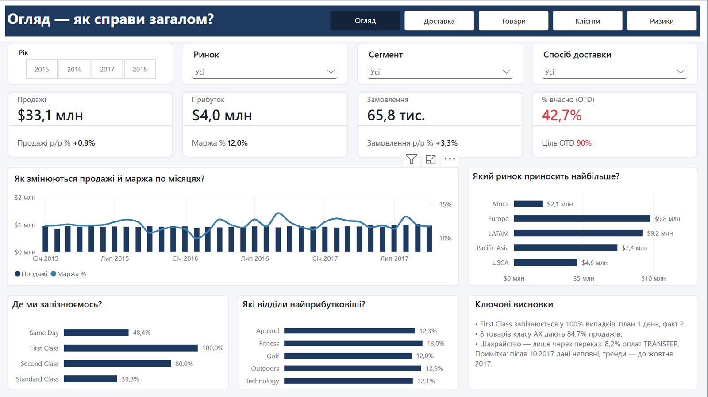
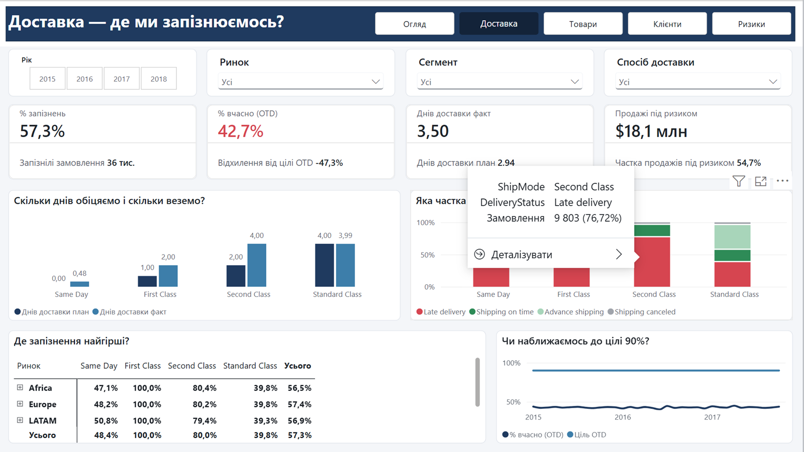
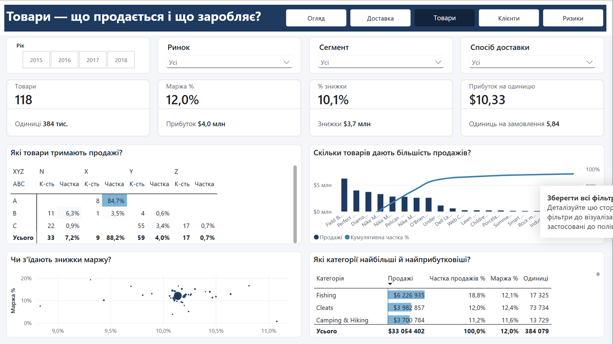
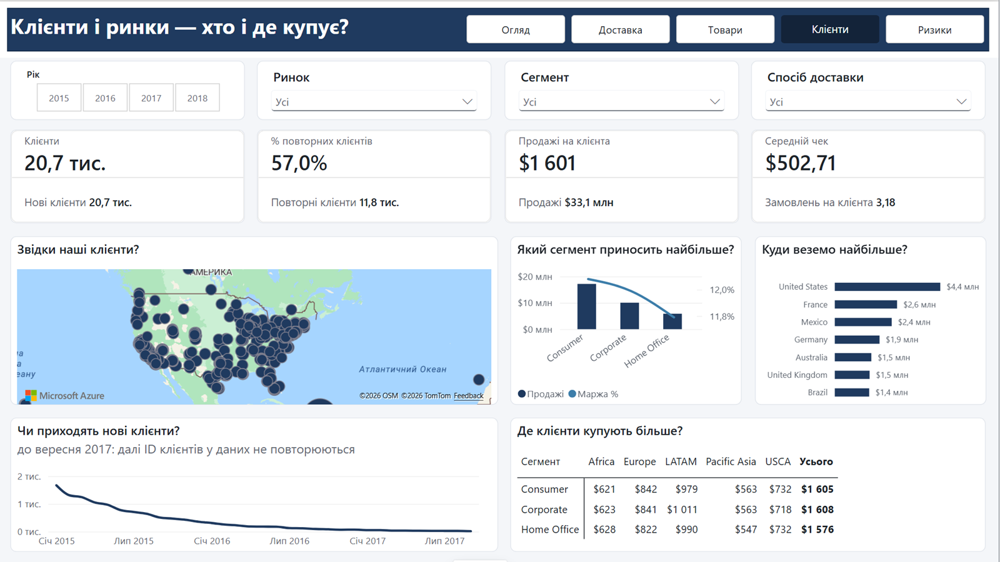
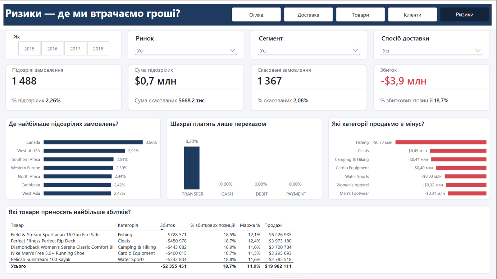
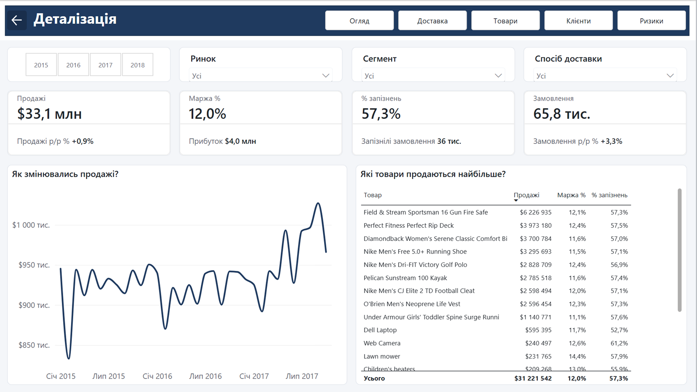
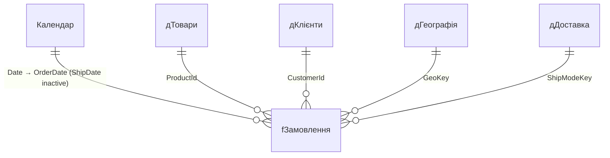

# DataCo Supply Chain — Power BI Report

[Українська](README.md) · **English**

A portfolio report on sales, delivery, products, customers and risks of an online sporting-goods retailer,
built on the open [DataCo Smart Supply Chain](https://www.kaggle.com/datasets/shashwatwork/dataco-smart-supply-chain-for-big-data-analysis)
dataset (180K order lines, 2015–2018). The report interface is in Ukrainian.

**Goal:** show where the company loses money and customer loyalty, and give a manager answers to
5 questions in 5 minutes: how are we doing overall, where are we late, what sells and what earns,
who buys and where, where are the risks.

## Key findings

Calculated with DAX queries against the model (no filters).

1. **Delivery is the main problem.** Only 42.7% of orders arrive on time vs. a 90% target.
   First Class is late 100% of the time: promised in 1 day, delivered in exactly 2. Second Class is late 80% of the time (2 days planned, 4 actual).
2. **Lateness is driven by shipping mode, not geography.** The worst region (Central Africa) has 60.0% late deliveries
   vs. a 57.3% average — regions differ by only ~3 pp, while shipping modes range from 40% to 100%.
3. **Sales rely on 8 products.** Class AX (high volume, stable demand) — 8 of 118 products — generates 84.7% of sales.
4. **Losses are spread across the whole assortment.** 18.7% of order lines are sold at a loss (−$3.9M);
   the most loss-making category is Fishing (−$0.73M at a 12.1% margin).
5. **Fraud comes only through bank transfers.** 2.26% of orders are suspected fraud ($0.74M), all paid by TRANSFER
   (8.2% of all transfer payments).

## Data limitations

The dataset appears to be synthetic: actual delivery days for Second and Standard Class are uniformly distributed
from 2 to 6, First Class always takes exactly 2 days against a 1-day plan, and the late-delivery rate is almost identical
across markets. The findings therefore describe the logic of the dataset rather than a real business. The report demonstrates
a methodology — data model, measures, ABC/XYZ, delivery service analysis — that can be applied to real WMS/ERP data.

## Pages

| | |
|---|---|
| **Overview — how are we doing?** KPIs with YoY comparison, sales and margin trend, markets, late deliveries, departments. |  |
| **Delivery — where are we late?** Planned vs. actual days, delivery status mix, region × shipping mode matrix, OTD vs. target. |  |
| **Products — what sells and what earns?** ABC × XYZ matrix, top-20 Pareto, discount vs. margin, categories. |  |
| **Customers & markets — who buys and where?** Customer map, segments, top-7 countries, new customers, segment × market. |  |
| **Risks — where do we lose money?** Suspected fraud by region and payment type, loss-making categories and products. |  |
| **Detail** (drill-through): right-click a category, region or shipping mode → "Drill through". |  |

Every page shares the same header with navigation and synced slicers: year, market, segment, shipping mode.

## Model

Star schema: one fact table (order line) and five dimensions. All relationships are 1:* with single-direction filtering.
Table names are in Ukrainian: `fЗамовлення` = Orders, `дТовари` = Products, `дКлієнти` = Customers,
`дГеографія` = Geography, `дДоставка` = Shipping, `Календар` = Calendar, `_Міри` = Measures.

- 51 measures in a dedicated `_Міри` table, organised in display folders (Sales, Trends, Delivery, Products, Customers, Risks) — see `measures.dax`.
- ABC (share of sales) and XYZ (stability of monthly demand within each product's active lifetime) are calculated in Python during data preparation.
- Dataset quirks and how they are handled are documented in `MODEL.md`: data drop-off after Oct 2017 (trends use the `IsCorePeriod` filter),
  a new customer ID on every order from Oct 2017, country names in Spanish (an `OrderCountryEn` column was added).

## How to open

1. Download `DataCoSupplyChainDataset.csv` from Kaggle (link above) into the repository root.
2. `python 01_prepare_dataco.py DataCoSupplyChainDataset.csv --out model_data` — builds 6 CSV files
   (the prepared files are already in `model_data/`, so this step is only needed for verification).
3. Open `DataCo.pbip` in Power BI Desktop (Power BI Project format: PBIR report + TMDL model).
4. If Desktop cannot find the data, change the `DataFolder` parameter (Transform data → Manage parameters) to the path of `model_data\`.

## Repository structure

| Path | Contents |
|---|---|
| `DataCo.pbip`, `DataCo.Report/`, `DataCo.SemanticModel/` | Power BI project (report and model as text files — readable diffs in git) |
| `01_prepare_dataco.py` | raw CSV cleaning, dimensions, ABC/XYZ, control totals |
| `model_data/` | prepared data |
| `MODEL.md`, `measures.dax`, `PAGES.md` | specification: model, measures, page layouts (in Ukrainian) |
| `theme/DataCo.json` | report theme |

## Data and license

Dataset: Constante, Fabian; Silva, Fernando; Pereira, António (2019),
"DataCo SMART SUPPLY CHAIN FOR BIG DATA ANALYSIS", Mendeley Data, V5,
doi: [10.17632/8gx2fvg2k6.5](https://doi.org/10.17632/8gx2fvg2k6.5).
License [CC BY 4.0](https://creativecommons.org/licenses/by/4.0/). Mirror on
[Kaggle](https://www.kaggle.com/datasets/shashwatwork/dataco-smart-supply-chain-for-big-data-analysis).
Files in `model_data/` are derived from this dataset (cleaning, dimensions, ABC/XYZ; see `01_prepare_dataco.py`).
