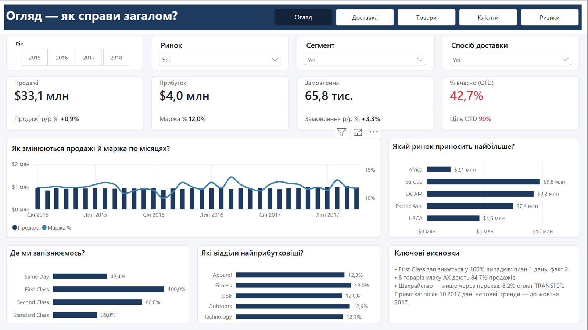
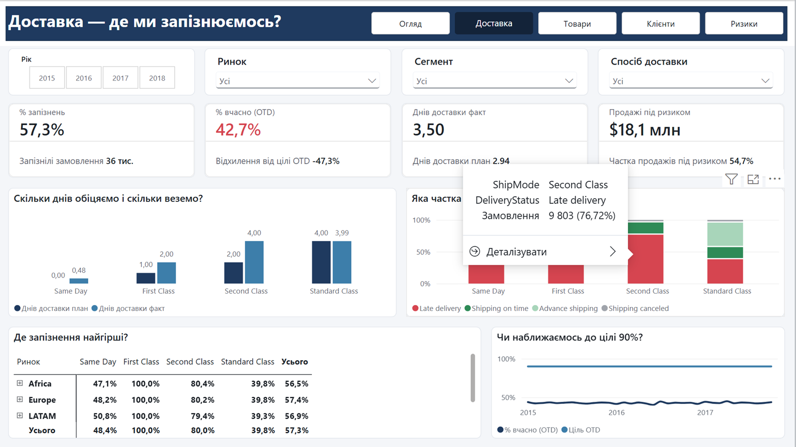
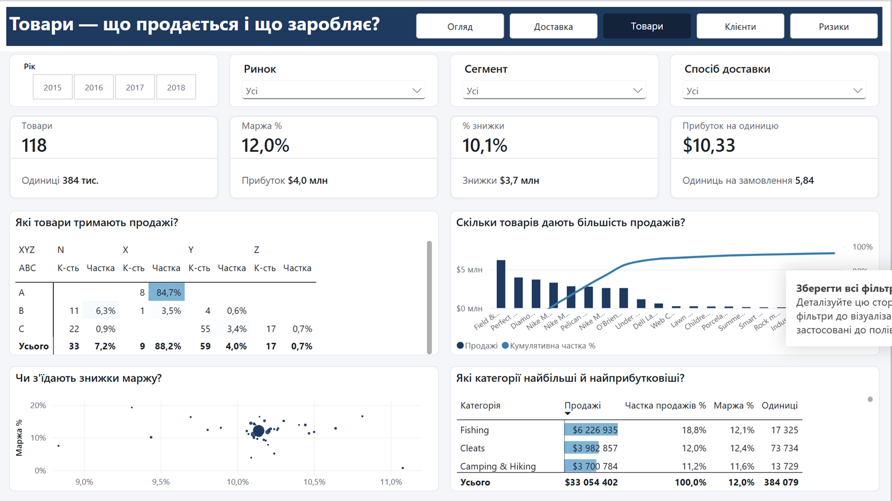
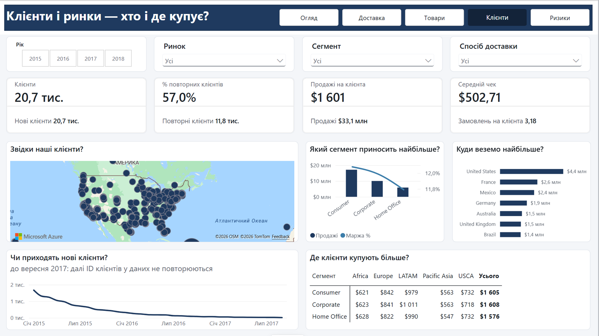
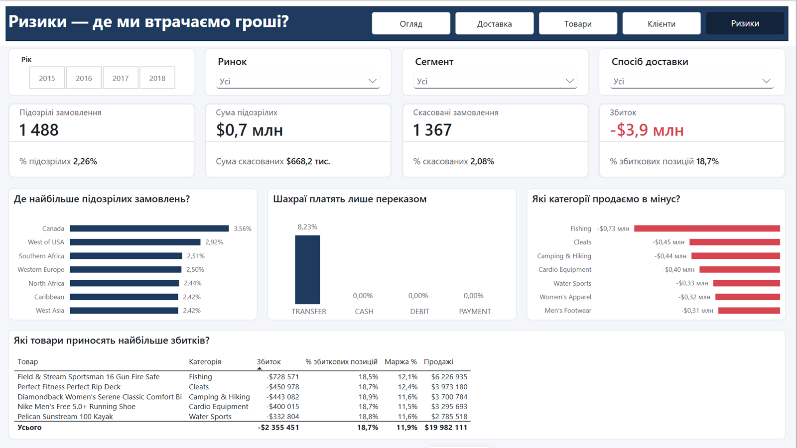
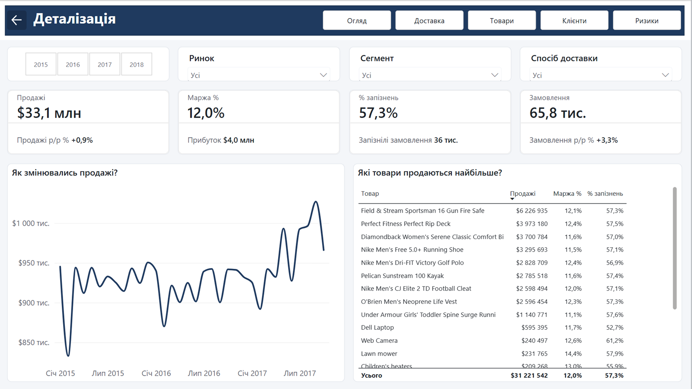
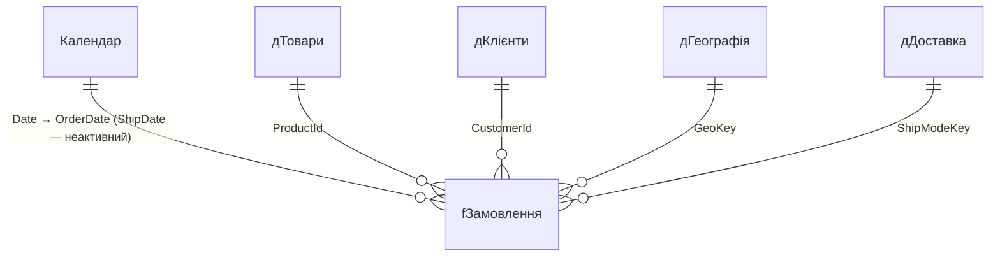

# DataCo Supply Chain — звіт Power BI

Портфоліо-звіт про продажі, доставку, товари, клієнтів і ризики інтернет-магазину спортивних товарів
на відкритому датасеті [DataCo Smart Supply Chain](https://www.kaggle.com/datasets/shashwatwork/dataco-smart-supply-chain-for-big-data-analysis)
(180 тис. позицій замовлень, 2015–2018).

**Мета:** показати, де компанія втрачає гроші й лояльність клієнтів, і дати менеджеру відповіді
на 5 запитань за 5 хвилин: як справи загалом, де ми запізнюємось, що продається й заробляє,
хто й де купує, де ризики.

## Головні висновки

Пораховано DAX-запитами до моделі (без фільтрів).

1. **Доставка — головна проблема.** Вчасно приходить лише 42,7% замовлень проти цілі 90%.
   First Class запізнюється у 100% випадків: обіцяємо 1 день, веземо рівно 2. Second Class — 80% (план 2 дні, факт 4).
2. **Проблема — у способі доставки, а не в географії.** Найгірший регіон (Central Africa) має 60,0% запізнень,
   середнє — 57,3%: розкид між регіонами лише ~3 п. п.
3. **Продажі тримаються на 8 товарах.** Клас AX (великий обсяг, стабільний попит) — 8 товарів із 118 — дає 84,7% продажів.
4. **Збитки розмазані по всьому асортименту.** 18,7% позицій продаються в мінус (−$3,9 млн);
   найзбитковіша категорія — Fishing (−$0,73 млн при маржі 12,1%).
5. **Шахрайство — лише через переказ.** 2,26% замовлень підозрілі ($0,74 млн), і всі вони оплачені TRANSFER
   (8,2% таких оплат).

## Сторінки

| | |
|---|---|
| **Огляд — як справи загалом?** KPI з порівнянням р/р, тренд продажів і маржі, ринки, запізнення, відділи. |  |
| **Доставка — де ми запізнюємось?** План проти факту, статуси доставки, матриця «регіон × спосіб», OTD проти цілі. |  |
| **Товари — що продається і що заробляє?** ABC × XYZ, Парето топ-20, знижка проти маржі, категорії. |  |
| **Клієнти і ринки — хто і де купує?** Карта клієнтів, сегменти, топ-7 країн, нові клієнти, сегмент × ринок. |  |
| **Ризики — де ми втрачаємо гроші?** Підозрілі замовлення за регіонами й оплатою, збиткові категорії й товари. |  |
| **Деталізація** (drill-through): правою кнопкою на категорії, регіоні чи способі доставки → «Деталізувати». |  |

На всіх сторінках — однакова шапка з навігацією і синхронізовані зрізи: рік, ринок, сегмент, спосіб доставки.

## Модель

Зірка: один факт (позиція замовлення) і п'ять вимірів. Усі зв'язки 1:*, фільтр в один бік.

- 51 міра в окремій таблиці `_Міри` з папками (Продажі, Динаміка, Доставка, Товари, Клієнти, Ризики) — `measures.dax`.
- ABC (частка продажів) і XYZ (стабільність місячного попиту в межах «життя» товару) рахуються в Python під час підготовки даних.
- Особливості датасету й рішення щодо них — у `MODEL.md`: обрив даних після 10.2017 (тренди з фільтром `IsCorePeriod`),
  нові ID клієнтів на кожне замовлення з 10.2017, назви країн іспанською (додано `OrderCountryEn`).

## Як відкрити

1. Завантажити `DataCoSupplyChainDataset.csv` з Kaggle (посилання вище) у корінь репозиторію.
2. `python 01_prepare_dataco.py DataCoSupplyChainDataset.csv --out model_data` — готує 6 CSV
   (готові файли вже лежать у `model_data/`, тож цей крок потрібен лише для перевірки).
3. Відкрити `DataCo.pbip` у Power BI Desktop (формат Power BI Project, звіт PBIR + модель TMDL).
4. Якщо Desktop не знайде дані — змінити параметр `DataFolder` (Transform data → Manage parameters) на шлях до `model_data\`.

## Структура репозиторію

| Шлях | Що це |
|---|---|
| `DataCo.pbip`, `DataCo.Report/`, `DataCo.SemanticModel/` | проєкт Power BI (звіт і модель у текстовому форматі — читабельний diff у git) |
| `01_prepare_dataco.py` | очищення сирого CSV, виміри, ABC/XYZ, контрольні цифри |
| `model_data/` | підготовлені дані |
| `MODEL.md`, `measures.dax`, `PAGES.md` | специфікація: модель, міри, макет сторінок |
| `theme/DataCo.json` | тема звіту |

## Дані й ліцензія

Датасет: Constante, Fabian; Silva, Fernando; Pereira, António (2019),
«DataCo SMART SUPPLY CHAIN FOR BIG DATA ANALYSIS», Mendeley Data, V5,
doi: [10.17632/8gx2fvg2k6.5](https://doi.org/10.17632/8gx2fvg2k6.5).
Ліцензія [CC BY 4.0](https://creativecommons.org/licenses/by/4.0/). Дзеркало на
[Kaggle](https://www.kaggle.com/datasets/shashwatwork/dataco-smart-supply-chain-for-big-data-analysis).
Файли в `model_data/` — похідні від цього датасету (очищення, виміри, ABC/XYZ; див. `01_prepare_dataco.py`).
